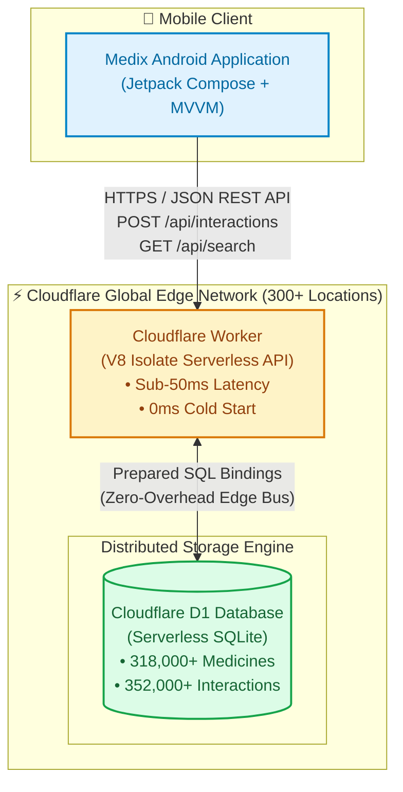
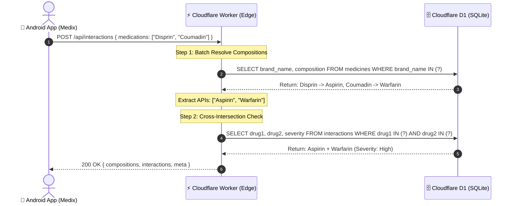

# Medix Backend — Serverless Drug-Drug Interaction (DDI) Detection API

[](https://workers.cloudflare.com/)
[](https://developers.cloudflare.com/d1/)
[](https://developer.mozilla.org/en-US/docs/Web/JavaScript)
[](./LICENSE)
[](https://medix-backend.medix.workers.dev/health)

> **Live Production API:** [https://medix-backend.medix.workers.dev/](https://medix-backend.medix.workers.dev/)  
> **Health Check Endpoint:** [https://medix-backend.medix.workers.dev/health](https://medix-backend.medix.workers.dev/health)

---

## 📋 Table of Contents
1. [Executive Summary](#-executive-summary)
2. [Problem Statement & Healthcare Context](#-problem-statement--healthcare-context)
3. [System Architecture](#-system-architecture)
4. [Algorithmic Innovation: 2-Query Optimization](#-algorithmic-innovation-2-query-optimization)
5. [Database Design & Data Engineering](#-database-design--data-engineering)
6. [API Specification & Endpoints](#-api-specification--endpoints)
7. [Directory Structure](#-directory-structure)
8. [Local Development & Setup](#-local-development--setup)
9. [Deployment Workflow](#-deployment-workflow)
10. [Academic & Project Evaluation Details](#-academic--project-evaluation-details)

---

## 🎯 Problem Statement & Healthcare Context

Polypharmacy the simultaneous prescription of multiple medications—is a leading cause of preventable hospital admissions and adverse drug events (ADEs) worldwide. Patients frequently receive prescriptions from different specialists without a centralized mechanism to identify contraindications.

Existing solutions either:
1. Rely on heavy centralized servers (e.g., Spring Boot, Django on AWS EC2) with noticeable latency and high idle hosting costs.
2. Require users to know the complex generic chemical ingredients (APIs) rather than the trade/brand names printed on their medicine boxes (e.g., searching for *Metformin* instead of *Glycomet 500*).

**Medix Backend solves both problems**:
* Translates commercial brand names into active generic chemical ingredients on-the-fly.
* Automatically evaluates all pairwise permutations for contraindications and returns classified severity grades (`High`, `Moderate`, `Minor`).
* Deployed at 300+ edge data centers worldwide, placing compute and data physically close to the user's Android device.

---

## ⚡ System Architecture



### Request-Response Lifecycle



### Why Cloudflare Workers + Cloudflare D1?

| Metric | Traditional Backend (AWS / Heroku / EC2) | Firebase / Supabase | Cloudflare Workers + D1 (Medix) |
|---|---|---|---|
| **Cold Starts** | 2 – 5 seconds (JVM / Container) | 500ms – 1s | **0 ms (V8 Edge Isolates)** |
| **Global Latency** | 150 – 400 ms (Single Region) | 80 – 200 ms | **< 50 ms (Edge-Routed)** |
| **DDI Query Handling** | High compute overhead | Inefficient for $\binom{n}{2}$ pairs | **Standard SQL `IN (...)` batching** |
| **Infrastructure Cost** | \$15 – \$50 / month | \$25+ / month | **\$0.00 (Generous Free Tier)** |
| **Daily Free Quota** | Limited instance time | 50k reads / day | **100,000 requests / day** |

---

## 🗄️ Database Design & Data Engineering

### Relational Schema (`schema.sql`)

```sql
-- Commercial Medicines & Formulations
CREATE TABLE medicines (
    id INTEGER PRIMARY KEY AUTOINCREMENT,
    brand_name TEXT NOT NULL,
    composition TEXT NOT NULL
);

-- Pairwise Drug-Drug Interactions
CREATE TABLE interactions (
    id INTEGER PRIMARY KEY AUTOINCREMENT,
    drug1 TEXT NOT NULL,
    drug2 TEXT NOT NULL,
    severity TEXT NOT NULL -- 'High', 'Moderate', 'Minor'
);

-- Performance Indexes
CREATE INDEX idx_brand_name ON medicines(brand_name);
CREATE INDEX idx_interactions_drugs ON interactions(drug1, drug2);
```

### Data Sources & Curation Pipeline

The database was compiled and cleaned from verified biomedical repositories:
1. **DDInter 2.0:** Clinical drug interaction repository providing classified interaction severities (`High`, `Moderate`, `Low/Minor`).
2. **DrugBank Open Data:** Standardized Active Pharmaceutical Ingredients (APIs) and generic chemical names.
3. **Kaggle Biomedical & Pharma Repositories:** Mappings for commercial formulations and Indian pharmaceutical brand names (e.g., *Dolo 650*, *Augmentin*, *Glycomet*).
4. **Data Sanitization & Ingestion:**
   * Dropped empty records and duplicate brand entries (case-insensitive deduplication).
   * Stripped nested `BEGIN TRANSACTION` and `COMMIT` statements to comply with Cloudflare D1's atomic batch ingestion engine.

---

## 📡 API Specification & Endpoints

### Base URL
```
https://medix-backend.medix.workers.dev
```

### 1. Health & Status Check
Returns server uptime, operational status, and available routes.

* **Endpoint:** `GET /health` or `GET /`
* **Method:** `GET`
* **Response:** `200 OK`
```json
{
  "service": "Medix Drug-Drug Interaction API",
  "status": "online",
  "version": "1.0.0",
  "architecture": "Cloudflare Workers + D1 Serverless SQL",
  "timestamp": "2026-10-29T12:00:00.000Z",
  "endpoints": {
    "health": "GET /health",
    "search": "GET /api/search?q={query}",
    "interactions": "POST /api/interactions"
  },
  "documentation": "https://github.com/bettercallshiv/medix-backend"
}
```

---

### 2. Medicine Autocomplete Search
Fast prefix-matching search used by the mobile app's input fields.

* **Endpoint:** `GET /api/search?q={query}`
* **Method:** `GET`
* **Query Parameters:**
  * `q` *(string, required)*: Minimum 2 characters.
* **Sample Request:**
```http
GET https://medix-backend.medix.workers.dev/api/search?q=dolo HTTP/1.1
```
* **Sample Response:** `200 OK`
```json
[
  "Dolo 650",
  "Dolo 500",
  "Dolo Cold Tablet",
  "Dolopar 650"
]
```

---

### 3. Drug-Drug Interaction Check
Analyzes an array of medication names and returns composition mappings along with all flagged clinical interactions.

* **Endpoint:** `POST /api/interactions`
* **Method:** `POST`
* **Headers:** `Content-Type: application/json`
* **Sample Request:**
```json
{
  "medications": [
    "Glycomet 500 SR",
    "Alcohol"
  ]
}
```
* **Sample Response:** `200 OK`
```json
{
  "compositions": {
    "Glycomet 500 SR": "Metformin",
    "Alcohol": "Alcohol"
  },
  "interactions": [
    {
      "drug1": "Alcohol",
      "drug2": "Metformin",
      "severity": "High"
    }
  ],
  "meta": {
    "analyzedMedicationsCount": 2,
    "identifiedIngredientsCount": 2,
    "interactionsFoundCount": 1
  }
}
```

#### HTTP Status Codes
| Status Code | Description |
|---|---|
| `200 OK` | Request processed successfully. |
| `400 Bad Request` | Missing or invalid `medications` array payload. |
| `404 Not Found` | Requested route does not exist. |
| `500 Internal Error` | Database execution exception. |

---

## 📂 Directory Structure

```text
Medix-Backend/
├── src/
│   └── index.js          # Core Cloudflare Worker API & 2-Query Engine
├── schema.sql            # D1 SQLite Table Schemas & Covering Indexes
├── package.json          # Project dependencies & npm scripts
├── package-lock.json     # Lockfile
├── wrangler.toml         # Cloudflare configuration with D1 database binding
├── .gitignore            # Git ignore rules (node_modules, .wrangler)
├── LICENSE               # MIT Open Source License
└── README.md             # Complete Project Documentation
```

---

## 🛠️ Local Development & Setup

### Prerequisites
* [Node.js](https://nodejs.org/) (v18.0.0 or higher)
* [npm](https://www.npmjs.com/) (v9.0.0 or higher)
* Cloudflare Account & [Wrangler CLI](https://developers.cloudflare.com/workers/wrangler/)

### Step 1: Clone the Repository
```bash
git clone https://github.com/bettercallshiv/medix-backend.git
cd medix-backend
```

### Step 2: Install Dependencies
```bash
npm install
```

### Step 3: Initialize Local SQLite Database
Run the bundled migration script to create the tables in your local Wrangler sandbox:
```bash
npm run db:init:local
```

### Step 4: Start Local Development Server
```bash
npm run dev
```
The local API will start at: `http://127.0.0.1:8787`

---

## 🚀 Deployment Workflow

To deploy changes to the live Cloudflare Edge network:

```bash
npm run deploy
```

Wrangler will package the ESModule bundle, sync bindings with Cloudflare D1, and deploy the live Worker across Cloudflare's global edge points of presence.

---

## 🧪 Testing with cURL

Test the live endpoint directly from your terminal:

```bash
# Health Check
curl -X GET "https://medix-backend.medix.workers.dev/health"

# Medicine Search
curl -X GET "https://medix-backend.medix.workers.dev/api/search?q=dolo"

# Interaction Check (Metformin + Alcohol)
curl -X POST "https://medix-backend.medix.workers.dev/api/interactions" \
  -H "Content-Type: application/json" \
  -d "{\"medications\": [\"Glycomet 500 SR\", \"Alcohol\"]}"
```

---

## 🎓 Academic & Project Evaluation Details

* **Project Title:** Medix: A Smart Medication Adherence and Drug Interaction Management System
* **Sub-System:** Backend DDI Detection & Medication Resolution Engine
* **Technology Stack:** Cloudflare Workers, Cloudflare D1 (SQLite), JavaScript (ESModules), Python (ETL)
* **Degree:** Bachelor of Technology (B.Tech) — Major Project Evaluation
* **Client Application:** Medix Android App (Native Kotlin, Jetpack Compose, Material Design 3)

---

## 📄 License
This project is licensed under the MIT License — see the [LICENSE](./LICENSE) file for details.

