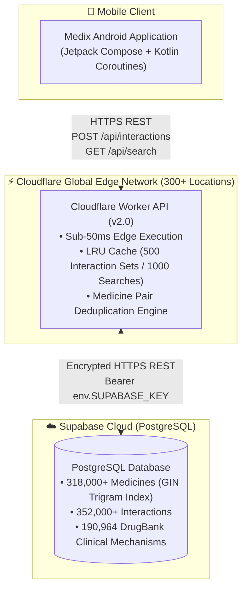
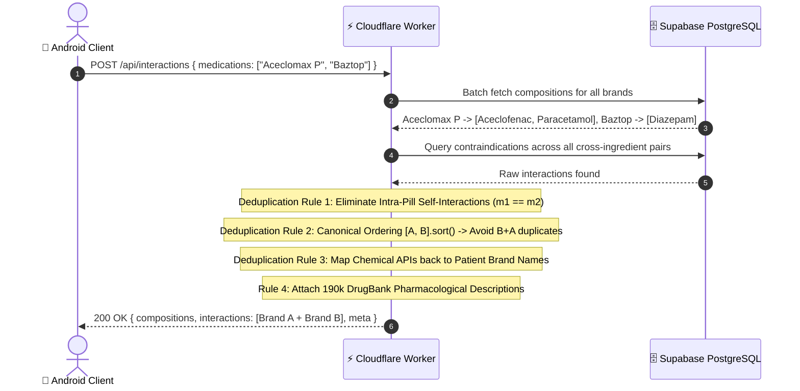

# Medix Backend — Serverless Drug-Drug Interaction (DDI) Detection Engine

[](https://workers.cloudflare.com/)
[](https://supabase.com/)
[](https://www.postgresql.org/docs/current/pgtrgm.html)
[](https://developer.mozilla.org/en-US/docs/Web/JavaScript)
[](./LICENSE)
[](https://medix-backend.medix.workers.dev/health)

> **Live Production Edge API:** [https://medix-backend.medix.workers.dev/](https://medix-backend.medix.workers.dev/)  
> **Health Check Endpoint:** [https://medix-backend.medix.workers.dev/health](https://medix-backend.medix.workers.dev/health)

---

## 📋 Table of Contents
1. [Executive Summary](#-executive-summary)
2. [Problem Statement & Healthcare Context](#-problem-statement--healthcare-context)
3. [System Architecture](#-system-architecture)
4. [Algorithmic Innovation: Deduplication & Trigram Search](#-algorithmic-innovation)
5. [Database Design & 190,000+ Clinical Descriptions](#-database-design--clinical-descriptions)
6. [API Specification & Endpoints](#-api-specification--endpoints)
7. [Zero-Secret Security Architecture](#-zero-secret-security-architecture)
8. [Local Development & Setup](#-local-development--setup)
9. [Deployment Workflow](#-deployment-workflow)
10. [Academic & Project Evaluation Details](#-academic--project-evaluation-details)

---

## 🚀 Executive Summary

**Medix Backend** is a high-performance, edge-native clinical safety backend serving the **Medix Android Application**. It provides real-time commercial medicine autocomplete and automated pairwise Drug-Drug Interaction (DDI) contraindication screening.

### Key Highlights:
* **Serverless Edge Execution:** Deployed across 300+ Cloudflare global data centers with sub-50ms latency and 0ms cold starts.
* **GIN Trigram Fuzzy Search:** Fast substring searching across **318,000+ Indian & international commercial medicines** via PostgreSQL `pg_trgm`.
* **190,964 Clinical Descriptions Enriched:** Enriched from biomedical DrugBank clinical interaction mechanisms to explain *why* drugs interact rather than just returning raw severities.
* **Medicine-Level Deduplication Engine:** Eliminates intra-pill self-interactions and reverse duplicates ($A+B \equiv B+A$), grouping alerts by the trade brands patients actually bought.
* **Zero-Secret Cloud Security:** Zero credentials committed to GitHub. Utilizes Cloudflare Worker encrypted secrets and `.dev.vars` sandboxing.

---

## 🎯 Problem Statement & Healthcare Context

Polypharmacy—the simultaneous ingestion of multiple medications—is a leading cause of preventable hospital admissions and adverse drug events (ADEs). In commercial pharmacy:
1. Patients buy commercial brand names (e.g., *Aceclomax P*, *Glycomet 500 SR*, *Augmentin*) rather than knowing pure generic chemicals.
2. Combination pills (e.g., *Aceclofenac + Paracetamol*) frequently trigger **false self-interaction alerts** when traditional tools screen ingredients in isolation.
3. Legacy platforms return cryptic alert codes or generic templates without pharmacological context.

**Medix Backend solves these clinical challenges**:
* Automatically resolves multi-ingredient combination pills into active chemical generic ingredients.
* Filters out self-interactions so a single pill never interacts with itself.
* Provides real clinical descriptions (e.g., *"The serum concentration of Abacavir can be decreased when it is combined with Alogliptin"*).

---

## ⚡ System Architecture



---

## 🔬 Algorithmic Innovation: Deduplication & Screening

When a patient inputs commercial medications (e.g., `Aceclomax P` and `Baztop 2mg Injection`):



---

## 🗄️ Database Design & Clinical Descriptions

### Relational Schema (`schema.sql`)

```sql
-- Commercial Medicines & Formulations
CREATE TABLE medicines (
    id BIGINT GENERATED BY DEFAULT AS IDENTITY PRIMARY KEY,
    brand_name TEXT NOT NULL,
    composition TEXT NOT NULL
);

-- Pairwise Drug-Drug Interactions with Clinical Explanations
CREATE TABLE interactions (
    id BIGINT GENERATED BY DEFAULT AS IDENTITY PRIMARY KEY,
    drug1 TEXT NOT NULL,
    drug2 TEXT NOT NULL,
    severity TEXT NOT NULL, -- 'High', 'Moderate', 'Minor'
    description TEXT        -- Real DrugBank pharmacological mechanism
);

-- High-Speed GIN Trigram & Covering Indexes
CREATE EXTENSION IF NOT EXISTS pg_trgm;
CREATE INDEX idx_medicines_brand_trgm ON medicines USING gin (brand_name gin_trgm_ops);
CREATE INDEX idx_medicines_comp_trgm ON medicines USING gin (composition gin_trgm_ops);
CREATE INDEX idx_interactions_drugs ON interactions(drug1, drug2);
```

---

## 📡 API Specification & Endpoints

### Base Production URL
```
https://medix-backend.medix.workers.dev
```

### 1. Health & Architecture Status
* **Endpoint:** `GET /health` or `GET /`
* **Response:** `200 OK`
```json
{
  "service": "Medix Drug-Drug Interaction API",
  "status": "online",
  "version": "2.0.0",
  "architecture": "Cloudflare Workers + Supabase PostgreSQL (Trigram Search)",
  "timestamp": "2026-11-04T12:00:00.000Z",
  "endpoints": {
    "health": "GET /health",
    "search": "GET /api/search?q={query}&detailed={true|false}",
    "interactions": "POST /api/interactions"
  },
  "documentation": "https://github.com/BetterCallShiv/medix-backend"
}
```

---

### 2. Fast Autocomplete Medicine Search
* **Endpoint:** `GET /api/search?q={query}&detailed={true|false}`
* **Query Parameters:**
  * `q` *(string, required)*: Search string (e.g., `paracetamol`).
  * `detailed` *(boolean, optional)*: If `true`, returns objects with `brand_name` and `composition`. Defaults to `false`.
* **Sample Request:**
```http
GET https://medix-backend.medix.workers.dev/api/search?q=aceclomax&detailed=true HTTP/1.1
```
* **Sample Response:** `200 OK`
```json
[
  {
    "brand_name": "Aceclomax P Oral Suspension",
    "composition": "Aceclofenac, Paracetamol"
  },
  {
    "brand_name": "Aceclomax Tablet",
    "composition": "Aceclofenac"
  }
]
```

---

### 3. Drug-Drug Interaction Contraindication Check
* **Endpoint:** `POST /api/interactions`
* **Sample Request:**
```json
{
  "medications": [
    "Alogliptin",
    "Abacavir"
  ]
}
```
* **Sample Response:** `200 OK`
```json
{
  "compositions": {
    "Alogliptin": "Alogliptin",
    "Abacavir": "Abacavir"
  },
  "interactions": [
    {
      "drug1": "Abacavir",
      "drug2": "Alogliptin",
      "severity": "Moderate",
      "ingredient1": "Abacavir",
      "ingredient2": "Alogliptin",
      "description": "The serum concentration of Abacavir can be decreased when it is combined with Alogliptin."
    }
  ],
  "meta": {
    "analyzedMedicationsCount": 2,
    "identifiedIngredientsCount": 2,
    "interactionsFoundCount": 1
  }
}
```

---

## 🎓 Academic & Evaluation Credits

* **Project Title:** Medix — Clinical Safety & Medication Adherence Management Platform
* **Component:** Edge-Native Drug-Drug Interaction Backend Engine
* **Target Mobile Client:** Medix Android
